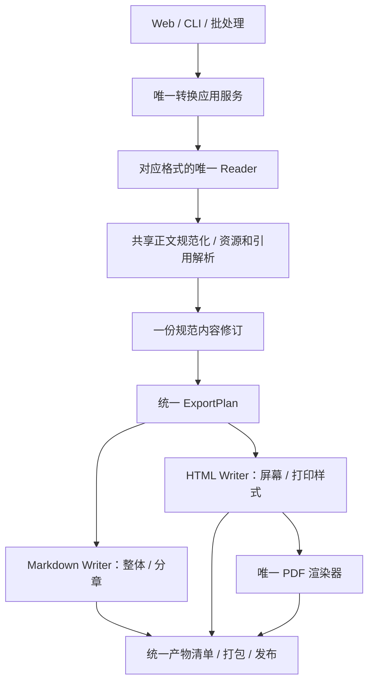

# 唯一转换实现与效果优先架构

更新日期：2026-10-15。状态：按当前工作区重新核对；本文描述目标，实际进度只在 TODO 记录。

本方案依据当前代码审计与用户最新要求重新制定：同一功能只维护一套正式实现，按实际转换效果取舍。它替代旧方案中的双轨迁移、Legacy Adapter、运行时回退开关及 M01–M17 顺序。旧文档和目录新旧不能作为保留某套实现的理由。

本文负责架构与取舍，[TODO](../TODO.md) 是唯一执行进度记录；[书籍与内容契约](0003-book-structure-and-navigation.md)、[存储契约](0004-sqlite-persistence.md) 是补充细则。历史方案通过 Git 查看，不再保留另一份可执行路线图。

## 1. 目标与边界

- 同一输入格式只有一个正式 Reader，同一输出格式只有一个 Writer；Web、CLI、批处理调用同一个应用服务。
- 同一来源只解析一次形成规范内容；整体、分章、HTML、PDF 是其输出视图，不各自识别正文、章节或资源。
- 保留有证据的优点、补齐缺口后替换原实现；不以“较新”“代码少”“移动到了 src”代表效果更好。
- 不提供新旧版本选择、双引擎兜底、永久旧模块包装。相同输入格式切换时，所有入口和输出一起切换，并删除原业务实现。
- 不为消除重复而删除必要能力。不同输入格式的 Reader，以及 PDF 原生提取与 OCR 的互补处理，属于不同职责；同一职责的规则、配置和输出代码只有一份。
- 本轮收敛现有输入和输出，不把本地新模型、人工编辑器、搜索、DOCX/EPUB 导出作为前置条件。

当前能力清单来自代码，表示需要核对和承接的范围，不表示已经通过效果验证：

| 输入 | 现有输出范围 | 收敛要求 |
|---|---|---|
| EPUB | 整体 MD、分章 MD、HTML、PDF | 所有入口统一章节树、资源与导出计划 |
| HTML | 整体 MD、分章 MD、HTML、PDF | 共同 Reader/Writer；来源基准和所有视图使用共享规则，验收范围见 TODO |
| DOCX | 整体 MD、分章 MD、HTML、PDF | 已在输入阶段保留 HTML/图片，复用共同正文与 Writer；验收范围见 TODO |
| PDF | MD、HTML、重排版 PDF | 原生文字、扫描页、混合页进入同一页级流程 |
| 图片 | MD、HTML、PDF | 复用唯一 OCR 客户端；范围以已验证图像类型为准 |
| URL | MD、HTML、PDF | 获取快照后复用正文解析、资源与导出能力 |

`.doc` 不等同于 `.docx`：当前能力表只接受 `.docx`，继续明确拒绝 `.doc`，不能伪称已覆盖旧版 Word。Markdown 导入先作为 PDF/OCR 返回协议的内部规范化能力；是否开放为用户输入另行明确。没有可靠章节的来源不虚构分章能力。

## 2. 现有代码的取舍依据

当前工作区的 `src/any_to_md` 已有章节树、spine 顺序、常见物理分片合并、稳定节点、资源哈希、导出计划和 SQLite。`BookRevision` 使用 schema 2 的有序 HTML 片段，节点引用片段；`content_markdown` 已移除。`application/convert.py` 经能力表加载 EPUB/HTML/DOCX Reader，共用 MD/HTML/PDF Writer；对应旧业务源码及独立批处理已删除。共同任务、存储和发布直接复用，接入状态不等于效果验收。当前进度只在 TODO 维护，阶段总结按 agent.md 归档；历史验证仅属于对应版本，不能据此宣布全部格式收敛完成。

旧 `epub_to_html` 的图片候选、锚点与跨文档引用等有效规则已在唯一 Reader 中承接，并补充了作用域样式、CSS 资源和条件导入；旧源码从正式运行路径移除，只在 Git 对照版本中保留。旧 EPUB MD 的重复正文和无目录异常不作为兼容要求。

候选方向是整合有用的结构能力、经样本确认的解析规则和更完整的唯一正文。现有新代码同样接受效果审查，关键能力未通过时继续修正；不因工作量已投入就默认保留。执行顺序和验收门槛只由 TODO 规定，不在本文保留另一套阶段安排。缺少其他格式的完整基线不阻止已经具备证据的格式收敛。

## 3. 唯一调用链



应用层唯一负责输入解析路由、执行、任务终态、导出与发布。Reader 不写最终 MD/HTML/PDF，Writer 不读取原 EPUB/PDF 绕过模型，不读取 Web 全局配置。PDF 渲染只消费 HTML Writer 的打印输出，不另建正文解释器。

能力表同时驱动输入校验、实际分派、输出选项和界面显示；环境缺少 OCR 或渲染依赖时返回具体不可用原因。不会因为某 Writer 存在就自动宣称所有格式组合均受支持。

目标目录仅表达职责，随实际实现建立，不预建空框架：

```text
src/any_to_md/
  domain/          # 规范内容、章节、来源、资源、诊断和产物契约
  application/     # 唯一转换服务、能力表、任务编排
  readers/         # epub、html、docx、pdf、image
  content/         # 共享 DOM 规范化、资源引用和外部 MD 结果导入
  export/          # 视图计划、命名、位置映射、清单与打包
  writers/         # markdown、html、pdf
  adapters/        # URL 获取、OCR、SQLite、本地存储、执行器
  interfaces/      # Web、CLI；批处理循环调用同一用例
  resources/       # 实际使用的字体、样式及模板
scripts/run/       # 必要的薄启动脚本，禁止业务实现
specs/             # 当前设计；不保留并列有效的旧方案
```

最终删除根目录转换包及 Web 业务分派副本。批处理采用唯一 CLI 的能力；旧命令默认撤下。仅有明确使用需求的别名可以纯转发参数，不能包含解析、命名、下载、写出等业务逻辑。

## 4. 唯一正文与渲染边界

规范正文选择可序列化的 XHTML/DOM 内容片段，保留标题、段落、列表、代码、图片、表格跨度、脚注、锚点及必要样式。当前类型名 `BookRevision` 可以沿用，不为旧文档中的 `DocumentRevision` 名称再造一份模型。章节树引用有序正文片段，每段正文只归属一次。先支持实际样本用到的元素，不另造完整富文本编辑系统。

- 持久正文只有这一种表示；Markdown、HTML 文件及缓存都是派生输出，不能再与模型分别编辑。
- 原文件、网页快照、OCR 原始响应作为溯源证据保留，不是第二份可绕行的正式转换实现。
- 把 `SourceLocator` 从 EPUB 专用键扩展到格式、资源及可选页/片段；保留来源锚点到规范节点的映射。
- 资源按内容哈希保存，多个源路径可映射到同一资源。相对路径、`srcset`、CSS 资源和必要字体统一解析；样式保留需处理文档作用域及打包位置。
- 章节清洗、代码识别和强调合并在规范化阶段实施，需保留原文语义。未验证的启发式不能无条件改写代码或正文。
- Markdown Writer 是唯一的 DOM→MD 序列化位置。简单表格输出 MD；复杂表格在同一 Writer 内保留可阅读的 HTML，记录兼容性限制，不能悄悄丢掉合并单元格、图片或链接。
- HTML Writer 从同一正文输出；PDF 只增加打印样式和排版。原始版面不保证像素一致，优先确保内容、结构、必要样式与阅读效果。
- 外部 PDF/OCR 若只返回 MD，经过一个共享导入函数规范化一次。上游已丢失的信息不能通过 MD→DOM 恢复，应记录缺失能力，不能据此宣称完整保真。

Writer 不再导入 `readers.epub.asset_token`；引用约定属于共享内容模型。哈希、文件命名、资源定位、清单采集和打包各有一个实现。产物清单采集一次，供导出清单与数据库共享；清单文件自身的记录单独处理，避免自引用哈希。

## 5. 各模块的去留

| 模块（含已删除的历史模块） | 进入唯一实现的内容 | 删除边界 |
|---|---|---|
| `src/any_to_md` | 章节树、顺序、资源、导出计划、存储骨架；原地升级正文契约 | Reader 提前写 MD、Writer 反向依赖 Reader 等旧路径 |
| `epub_to_md` | 仅迁入样本证实有益且尚未覆盖的规则 | 整包及独立 CLI，不保留旧引擎 |
| `epub_to_html` | 图片候选、锚点、内部链接等有效规则 | 独立 EPUB 解析和导出管线 |
| `html_to_md` | HTML 输入与资源处理的有效规则 | 单文件/分章各自读取、复制和转换的编排 |
| `docx_to_md` | Mammoth 读取、图片和诊断 | 包内 MD 转换与最终文件写出 |
| `url_to_md` | HTTP 获取、正文提取、标题及来源规则 | 同步/异步两份提取逻辑及独立输出 |
| `pdf_to_md` / `ocr_to_md` | 原生提取与唯一 OCR 客户端 | 两份采样规则、同步业务副本、对 `web.config` 的依赖 |
| `html_to_pdf` | 经验证的 WeasyPrint 调用、打印样式和字体 | 根包及各输入分支自己的 PDF 编排 |
| `web/services` | 业务需求由唯一应用服务承接 | 转换分支、第二套任务状态、文件/产物寻址规则 |
| `md_to_any` | 迁出被运行代码实际使用的资源 | Java 历史实现及无消费的运行资源；历史由 Git 保留 |
| 根目录批处理/旧 CLI | 批处理和参数需求由统一 CLI 承接 | 自行组织转换链的脚本；词汇实验脚本移出正式转换源码 |

每次移植必须删除原实现，不能把同一函数复制到目标目录后长期双维护。删除源码不删除用户原文件、书库、数据库和已导出文件。

## 6. PDF 与 OCR 的唯一流程

一个 PDF Reader 负责页枚举、有效文字判断、原生提取、必要 OCR、去重和按原页序组装。两个现有扫描判断函数合为一个分析结果；不再以默认前几页的均值决定整本路线。

原生提取与 OCR 针对不同页面条件，可以在一个任务中组合。每页必须有覆盖及处理状态；混合页采用已经验证的整页或区域策略，不能同时追加两份全文。OCR 缺失、失败或低质量内容显式报告；坏 PDF 不能直接当扫描件发送。

本轮只收敛现有 OCR 服务客户端，不并列接入多个后端。服务仅支持整文件或缺乏页级输出时，先核实单页提交能力；无法验证页覆盖则不宣称页级能力已完成。模型更换是同一 provider 的替换决定，需另外采样评估。

## 7. 效果选择和完成标准

“效果最好”指约定输入范围、真实样本及运行环境下的结果，不宣称对所有文件绝对最优。比较时先检查不可退让的完整性，再比较阅读质量，最后比较速度和资源消耗。

1. 对照原文件或独立标注，检查正文不漏、不重、顺序正确。模型内部自检不能证明 Reader 没有提前丢内容。
2. 检查章节边界、层级、目录、长标题、重复标题、无目录及跨文件章节。
3. 检查图片、候选图、表格单元格/跨度、脚注、代码和内部引用；搬移导出包后仍可访问。
4. MD 做语义、资源和链接断言；HTML/PDF 做代表性页面渲染检查，覆盖中文、缺字、裁切及图表。
5. OCR 另用人工校对的文字/表格/页覆盖基准，不用“请求返回成功”替代识别效果。
6. 相同输入和选项在 Web、CLI、批处理得到等价内容、资源与诊断；比较时排除运行 ID、时间等非内容字段。
7. 比较前固定逐样本判定表，写明覆盖、资源/链接预期、视觉检查点、允许差异和 OCR 误差判定方法。候选选取记录包含样本、版本、环境、优劣项、限制和结论；不能在看到结果后调整通过标准。关键能力未通过时继续补齐唯一实现，不靠平均分掩盖退步。

代码实现期应建立有意义的回归检查并执行相关集成、安装和渲染验证。旧文档中的“禁止自动测试”“每个 M 节点必须等待人工确认”不沿用。人工检查负责阅读质量和难以自动断言的效果，不替代可自动检查的结构完整性。

现有仓库的真实样本覆盖不足，不能据静态代码选出已验证的赢家。先用现有样本和可控的小型样本建立基线，再补足代表性文件；缺少 OCR 环境或样本时明确标记未验证，推进不依赖它们的工作。

## 8. 切换与删除规则

按输入格式实施原子切换：完成共同能力 → 验证该格式全部现有输出 → 同一变更切换全部入口 → 删除对应旧实现和导入 → 检查安装与调用链。共享模块先迁入唯一位置、把所有消费者指向它，再删除原位置。

首次正文模型升级、EPUB Reader、共享 Writer、共同执行/发布及实际需要的旧数据处理属于同一发布单元。当前共同能力已有实现，发布前仍须与最终 EPUB 代码一起验证，不能因旧阶段编号把工作重复安排一次。先盘点真实存量和使用入口，历史导出可只读保留，不预设必须批量改写所有快照。不能独立发布破坏现有数据访问的模型，也不能增加长期旧 MD Writer 或旧转换引擎来跨越阶段。

开发中可以在隔离环境用 Git 旧版本生成比较结果，但不把旧转换源码复制进正式源码、安装包或运行时。已经切换的格式不保留引擎开关或旧实现 fallback；发布失败回退整个版本，恢复数据按备份/迁移方案执行。

在完成全部格式前，尚未替换的格式继续使用其现有路径并列为待收敛项；不得为同一格式再发布一条路线。每个格式从效果验证到入口切换和删旧形成完整交付，不把删除无限后移。规划完成、增加目录或把旧代码复制到新位置，都不等于实现收敛。
