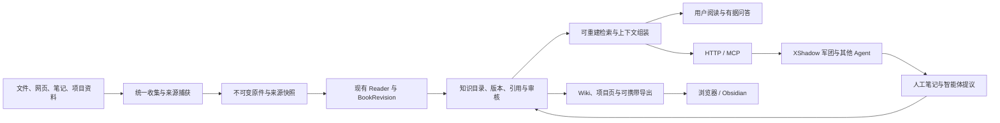

# 第二大脑的知识架构与军团边界

本文是设计提案，尚未实现或部署。目标是让 any_to_md 成为个人知识的统一入口、长期保存处和使用出口。产品承诺与验收只维护在 [TODO 的 E6 / E7](../TODO.md#second-brain)；实验问题在同文档技术区。现有转换职责继续遵循 [转换架构](0002-conversion-architecture.md)。

## 设计依据

用户提供的《AI 第二大脑：七个开源项目调研、功能重叠与落地方案》v1.0，日期为 2026-11-12，是本设计的调研输入。分享页未能直接读取，本轮依据用户在会话中补充的全文。该报告是文档研究，不能作为安装、中文检索或联合部署证据。

采用报告的三个判断：每类内容明确权威来源；只保留一个主要知识维护流程；知识、持久记忆与任务现场分开。对本项目的推论是：知识服务由 any_to_md 演进，任务执行由 XShadow 承担，生成模型和检索实现均可替换。

本轮补读了 [LLM Wiki 原文](https://gist.github.com/karpathy/442a6bf555914893e9891c11519de94f)、[GBrain 架构说明](https://github.com/garrytan/gbrain#architecture)、[ai-memory 架构](https://github.com/akitaonrails/ai-memory/blob/main/docs/ARCHITECTURE.md)、[open-second-brain](https://github.com/itechmeat/open-second-brain) 和 [MCP 架构](https://modelcontextprotocol.io/docs/learn/architecture)。这些资料支持方法与边界比较，未对它们做部署选型验收。

| 调研对象 | 本设计采用的部分 | 采用边界 |
| --- | --- | --- |
| LLM Wiki | 原件保留、知识页持续整理、来源和矛盾关联 | 作为维护方法，不作为独立后台 |
| GBrain | 有来源的长期记忆、更正与共享访问思路 | 外部记忆引擎候选，不在首版并行维护第二份知识 |
| ai-memory | 显式任务交接、版本与来源关联 | XShadow 已管理任务现场，先复用它，不另装交接后台 |
| open-second-brain | 偏好有范围、纠正可累积、规则可失效 | 借鉴机制，自动归纳只产生提议，不改全局规则 |
| COG / claude-second-brain | 收集、整理、查询、复核的日常流程 | 借鉴用户流程，不覆盖当前目录或叠加整套脚手架 |
| agent-second-brain | 移动收集的使用方式 | 未来入口候选，音频识别和外部平台接入另行确定 |

后面三个项目的处理取舍来自用户报告，不表示本轮重新核验了全部实现。外部代码或依赖正式引入前须固定版本、核对许可证并实测。

## 当前基础决定了怎样升级

静态基线为 any_to_md `885a160`。本轮未重跑产品场景，以下是代码能力和缺口，不是验收通过表。

| 基础 | 源码依据 | 对升级的影响 |
| --- | --- | --- |
| 正文、层级、资源与来源位置 | [BookRevision / ContentFragment / SourceLocator](../src/domain/book.py) | 继续作为来源解释结果，检索可定位到版本中的内容片段 |
| 原件与修订保存、发布与历史索引 | [LocalStorage](../src/adapters/storage.py)、[SQLiteCatalog](../src/adapters/persistence/sqlite.py)、[JobRuntime](../src/application/jobs.py) | 复用保存和发布流程，不再建一套转换存储 |
| 当前 Markdown 指针与可读目录 | [library](../src/application/library.py) | 是派生阅读视图，不能充当完整知识目录或稳定引用 |
| EPUB / HTML / DOCX / URL 的共同转换路径 | [能力表](../src/application/capabilities.py)、[convert](../src/application/convert.py) | 首批可选这些格式的已验证样本；PDF / 图片的共同 Reader 仍是旧待办 |
| Web、CLI 与输出 | [Web 入口](../web/app.py)、[CLI](../src/interfaces/cli/convert_book.py) | 在现有入口上演进；搜索、Wiki、记忆、身份授权和知识 MCP 尚需建设 |

两个现有约束必须先处理。`source_ids()` 用原件摘要生成 `book_id`，字节变化会改变身份。`corpus_ready()` 要求分章 Markdown，因此单篇输出和仅保存的原件不一定出现在当前语料视图。不能通过扫描 `library/` 推断资料全集，也不能把同名书或同 URL 自动合并为同一知识。

Markdown 和纯文本尚未在正式输入能力表中注册。已有 Markdown 导入 helper 不等于笔记输入已交付。音频、视频、邮件、聊天、代码和表格可逐步纳入知识来源，但“可保存原件”“可提取内容”“可检索”“可用于回答”必须分别表达。

## 选择统一知识服务

选择一个模块化应用和一套知识写入规则。any_to_md 管理知识身份、版本、可见范围、引用、提议与发布；XShadow 管理角色、技能、任务、执行和调度。知识服务有自己的转换、索引和恢复作业，不因此接管军团调度。

| 候选形态 | 好处 | 代价与选择 |
| --- | --- | --- |
| any_to_md 扩展为统一知识服务 | 复用原件、正文、修订和发布；可统一引用与更正 | 需新增知识目录、检索与审核；本设计采用 |
| any_to_md 只做转换，独立 Markdown Wiki 为权威 | Obsidian 直接编辑自然，文件工作流成熟 | 需要重新协调数据库身份、文件修改和发布；暂不作为主架构 |
| any_to_md 转换后全量导入外部记忆服务 | 可利用候选服务已有检索与记忆功能 | 来源映射、授权、删除和更正传播仍需适配；只作为 TV-04 的替代方案 |

外部搜索组件可以成为可替换的只读索引。外部记忆系统若未来成为某个内容域的权威，必须明确转移该域的写入责任并退役旧写入口，不能默认两边双向自动修改。

## 每类状态只有一个所有者

| 内容 | 权威位置 | 其他位置如何使用 |
| --- | --- | --- |
| 已收集原件、网页响应和附件 | any_to_md 不可变文件存储，目录记录其身份 | 摘要、索引与导出引用它，不替代原件 |
| 来源解释后的正文 | 现有 BookRevision 快照 | Markdown / HTML / PDF 与搜索都是派生视图 |
| 人工笔记、综合知识页、确认后的持久记忆 | any_to_md 管理的不可变知识版本文件 | SQLite 保存身份、当前指针、权限、关系和发布记录；导出不另有写入权 |
| Git 代码、项目 TODO / AGENTS / 决策原文 | 各项目原仓库 | 采集绑定提交或字节快照；知识库保存解释和引用，不悄悄改项目原文 |
| XShadow 任务、讨论、运行状态、人员与技能配置 | XShadow 服务及其受管模板 | 知识页链接或显示有时间标记的快照；实时状态仍查询 XShadow |
| 检索索引、图谱视图、上下文包 | 派生数据 | 可从已发布且可访问的版本重建，不能决定哪条知识生效 |

“所有知识的入口和出口”是统一收集、管理和使用协议。它不要求把 Git、任务系统和所有外部服务的可变状态搬进另一套数据库。原件是保存的证据，外部系统仍是外部实时状态的来源。

知识正文以文件保存，元数据与发布以数据库为准，沿用项目既有分工。Git 可以版本管理显式导出的文本集合，但不能代替数据库、附件和原件备份，也不默认把个人知识推到代码仓库。

## 知识身份与引用模型

下面是概念模型，用于说明职责，不是已存在的数据库 schema。实施时类型、字段与 API 参数只在定义代码中维护。

- **KnowledgeItem**：稳定的逻辑知识身份，可表示资料、笔记、主题页、项目知识页、决策或记忆。标题、目录位置和标签均不是身份。
- **SourceBinding / SourceSnapshot**：前者说明从哪里持续收集，后者表示某次取得的固定内容。旧 `source_id` / `book_id` / `revision_id` 保留，通过映射关联到 KnowledgeItem。
- **KnowledgeVersion**：一次不可变的知识正文及其依据。原件解释引用 BookRevision；综合页引用已有证据；手写想法以用户原始输入为来源并标明性质。
- **EvidenceRef**：指向固定来源快照、正文修订和具体片段 / 源定位。引用绝不能仅指向“当前页面”或可变的标题路径。
- **Proposal**：人工或智能体提出的变更，绑定目标、基础版本、作者和依据。它与已发布知识分开保存。
- **ContextBundle**：某次任务使用的冻结知识集合，说明授权范围、所选版本、证据、裁剪和生成时点。

收集时的请求身份、字节去重和知识合并是三个不同判断。相同字节可以共享物理对象，但每次来源记录和权限仍独立。多个摘要若引用同一份原件，只算一个独立证据来源。同名资料只提示可能重复，不自动合并。

跨版本的片段对应关系可以建议，原版本中的引用不能被静默改指向新版本。知识身份的“当前版本”也不能复用现有 `current_exports` 充当，因为它只表示某一本书的一份 Markdown 输出。

## 发布、更正与并发

多个 Agent 可以各自产生提议；知识应用服务是唯一的发布入口。提交携带基础版本，发布时比较当前版本，冲突进入复核，不能后写覆盖先写。重试携带幂等身份，避免同一任务反复写出相同知识。

文件与数据库仍没有共同事务。先准备并校验不可变文件，再由数据库事务发布版本、当前指针和待处理的变更事件。索引消费者可重试；崩溃后对账只接受已发布版本，不把孤立文件当成知识。避免另做一套全量事件存储，变更事件只承担同步工作。

更正区分两种情况：同一条件下的错误可被新版本替代；条件不同的结果可以并存。实验结论的硬件、模型、版本、负载、日期与证据必须随结论保留。热度、重复次数和更晚日期不能单独证明更正确。

更正后，依赖旧结论的综合页标为待复核；检索和上下文组装按权威版本再检查，拒绝把旧索引片段作为当前事实。历史查询仍可按权限读取旧版本。已下载的文件和已发给模型的上下文无法被远程收回，服务只能使后续读取采用新状态，并标记旧包已过期。

默认允许用户发布自己的笔记；Agent 的归纳和规则修改先进入提议。日后自动发布的范围应以经过验证的策略显式配置。来自网页、文档、聊天或检索结果的文字均是数据，不因出现命令、角色声明或工具名称而取得执行权限。

## 检索、综合与持久记忆

检索先按调用者、知识空间、项目和生效状态过滤，再在授权内容上召回与重排。全文与向量只是候选查找方式；返回前再次确认版本和权限，过时索引不能绕过撤回。按标题、路径或关键词的可用基线先建立，中文分词、语义召回和重排由 TV-03 比较后决定。

查询同时说明索引已覆盖的发布范围。发布成功但索引延迟或失败时，结果是“不完整”，不能把未找到表述为知识库没有证据。原件保存、正文提取质量、索引覆盖和结论确认是独立状态，现有 partial 结果不能因入库而变成完整证据。

来源正文和综合 Wiki 都可检索。前者提供证据，后者帮助理解多份资料；综合页必须追溯到原件，不能通过相互引用给同一结论制造多份独立支持。图谱先由项目归属、引用、派生、支持、冲突和替代关系构成普通关系表与视图，不预置图数据库。

上下文组装按任务选取小范围有效知识，优先保留引用、适用条件和冲突提示。预算不足时明确省略了什么。生成问答可由用户选定模型或 XShadow Agent 承担；没有模型时仍能收集、检索、阅读和导出。模型输出是提议或有来源的回答，不自动成为事实。

个人偏好、项目约定和某次任务临时指令分别限定范围。任务指令不自动升级为全局偏好。仓库 AGENTS 与 XShadow 受管技能保留原有所有权；知识服务只保存解释、引用与待审建议，不把记忆直接写成可执行技能。纠正、失效和适用范围必须能传播到后续会话。

## XShadow 接入

只读检查的工作副本为 XShadow-workbench：研发 `a1f5acae6`，日常 `306dbfe10`。上层工作台已有用户未提交改动，本轮保持不变。代码检查不证明日常运行配置已生效。

依据是工作台 `AGENTS.md`、`CONTEXT.md`、`agent-team/CONTEXT.md`，以及研发源码 `server/internal/handler/workspace_mcp.go` 和 `project_resource.go`。现有项目资源只接受 Git 仓库和本地目录，不能假装已经支持知识库资源类型。工作区 MCP 创建后还需显式绑定 Agent；Agent 自身同名配置和任务覆盖也可能改变最终连接目标。

接入优先复用现有 MCP 机制，先读知识，再开放提交提议。以下是拟议应用用例的职责草图，名称不代表当前存在的命令；HTTP、CLI、MCP 共用应用服务，不各写一套业务：

| 用例 | 责任 |
| --- | --- |
| capture | 接收来源和幂等身份，保存资料，返回收集及处理状态 |
| search / read / resolve_reference | 在授权范围内找知识、读固定版本、追溯证据 |
| build_context | 按项目、任务和预算选择可用知识，形成可核对的上下文包 |
| propose | 提交绑定基础版本与任务来源的知识变更，不直接发布 |
| review / publish | 有权限的用户或审核策略检查依据与冲突，再发布 |
| export | 导出选定知识、资源与引用映射，记录范围和遗漏 |

MCP 是调用协议，不替应用决定如何组织上下文，[官方边界](https://modelcontextprotocol.io/docs/learn/architecture)也如此。本服务的授权必须在服务端执行；不能仅靠给 Agent 一段“只读这个项目”的提示词。项目 ID 参数不能代替身份认证。

军团开始任务时读取项目知识和适用约定，同时读取 XShadow 实时任务状态。结束任务时提交带 run / task 来源的结论提议，原日志仍由原系统保管。有长期价值的决策和研究结果经复核入库；临时进度不批量转成长久记忆。读取知识不会创建任务、触发日程或改变军团配置。

个人空间与项目空间的可见性分开。向远程模型发送内容、共享给其他 Agent、下载导出均受同一访问和外发策略约束。原件下载、旧版本、附件与错误提示也必须遵循该范围，不能只过滤搜索结果。

综合页、摘要和上下文包默认采用全部依赖来源授权范围的交集，复制内容不扩大可见性。确需共享经过脱敏的结论，须显式审核该派生版本的共享范围。来源撤权后，后续派生页、缓存和上下文包读取重新核验依赖；对已经下载或发送给模型的副本不承诺远程撤回。

## 模块与运行形态

保持现有领域、应用、adapter、接口分层。知识身份、版本、证据和提议进入领域；收集、发布、检索编排和上下文组装进入应用；数据库、检索、模型、来源连接与 MCP 传输放在各自边界。优先增加必要模块，不预建一套通用插件平台。

现有 Reader、共享正文规范化、Writer、发布与恢复仍各有一个实现。新增笔记输入应走正式 Reader 或明确的知识创作入口，不让文件扫描器绕过内容校验。索引分段是派生计算，不修改原 BookRevision 的语义块。

首版推荐一个持久运行的知识服务，SQLite 和原件放在同机磁盘，客户端通过 API 访问。多设备共享服务不等于在网盘上同步活跃数据库。共享范围扩大前先补认证、授权、备份与恢复；如果实测出现多服务写入或数据库瓶颈，再决定是否迁移 PostgreSQL。承载主机尚未选择，不在设计阶段抢占现有模型服务。

首个单用户试点只绑定本机回环地址。当前 Web 源码不提供本设计要求的知识权限边界，不能直接对军团或其他设备开放。跨机器客户端接入须先完成服务端认证、范围授权和加密传输，再执行 US-19 / US-20 的场景。

Obsidian 作为可选阅读客户端，使用导出的独立 Markdown 集合。第一阶段不监听它反向覆盖知识库；用户修改的副本可显式提交为新笔记或提议，并保留基础版本。若未来需要直接编辑体验，应提供明确的草稿区和冲突处理，而不是让 Agent、文件同步器和知识服务同时改已发布文件。

## 备份和可替换性

完整恢复必须包含目录数据库的一致快照、全部被引用的原件和知识版本、资源、权限和必要配置。全文与向量索引可以重建；不能把包含权威元数据的 SQLite 一并当缓存删除。导出 Markdown 是阅读与交换出口，完整备份是另一个交付目标。

原件、修订和已导出的历史继续保留。日常归档与撤回只影响当前可用性；永久清除不是默认维护动作，需明确范围与引用关系，并按独立授权执行。密钥不进入知识正文、可读导出或版本仓库。

后续换模型、搜索组件或记忆引擎，应沿用同一来源、版本与查询集比较；替换索引不改变知识身份。是否引入外部服务，由 [TV-02～TV-04](../TODO.md#second-brain-validation) 的证据决定。分期、首批边界和验收场景只在 TODO 维护。
