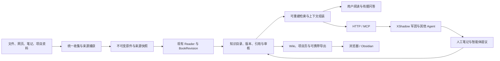
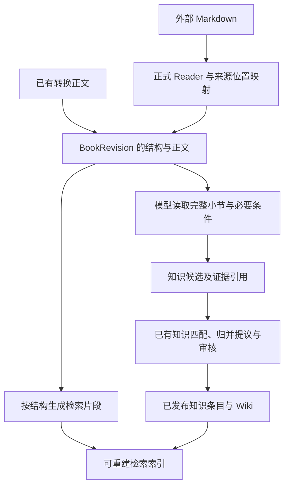
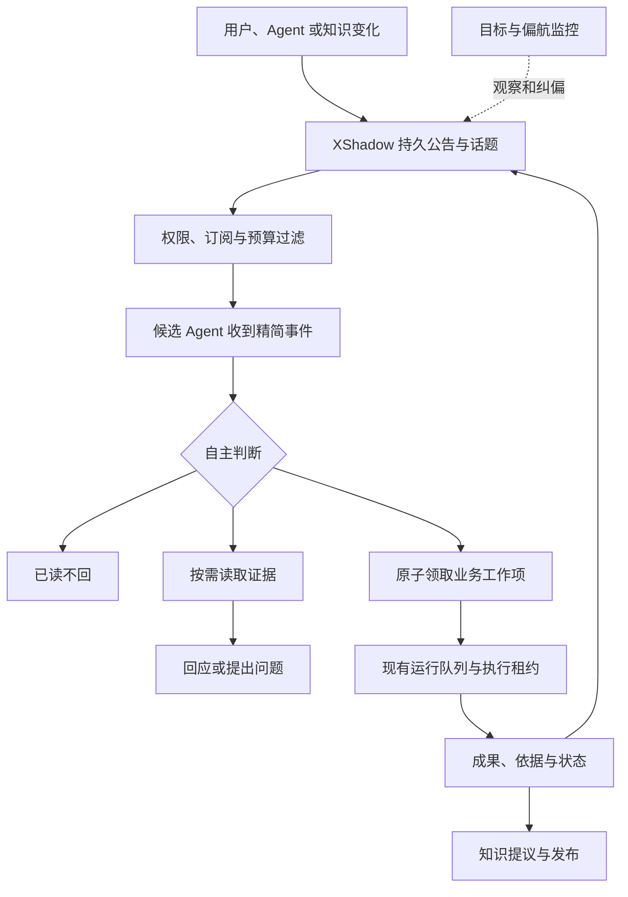

# 个人第二大脑：总体架构与技术方案

本文是唯一现行架构方案，统一转换、知识管理与 XShadow 协作边界。设计尚未全部实现，拟议对象与接口不代表已交付。产品行为以[场景](../tests/common/README.md)和 [TODO 产品区](../TODO.md#product-backlog)为准，未完成实验在 [TODO 技术区](../TODO.md#technical-validation)，执行交接留在 TODO。历史方案通过 Git 查询。

## 方案结论

当前执行路线是先以固定提交纳入七个开源方案，用隔离主项目连接现成能力跑通最小链路，再按真实证据决定采用、薄适配、吸收或放弃；统一知识服务仍描述目标能力与领域模型，但不是本轮已实现的交付路径。any_to_md 保留为独立的文档模块，独占原件、正文修订和导出；主项目负责授权、资料身份和跨模块交接。XShadow 管理话题、任务、Agent、执行及偏航监控。各方通过稳定引用和接口连接，各自管理自己的数据。

基线、固定提交和真实串联证据见[当前执行基线](#module-combination-baseline)。组合跑通不等于产品验收，未跑通的模块按源码、运行和集成三个层级分开记录。

- 用户可以持续收集书籍、文章、笔记与项目资料，按主题或项目阅读、检索、修正并导出。
- 知识分为原始证据、可复用理解、个人偏好和项目决策。临时任务现场继续归 XShadow，经过核对的成果再沉淀。
- 多个 Agent 可以整理知识，但通过同一提议和发布接口协作。每个结论保留来源、条件、版本与冲突。
- 公告栏先按权限和订阅过滤小事件，相关 Agent 再决定读取、回应或领取任务。leader 只监控目标、争议与偏航。
- 上下文由任务需要决定，按需取得摘要、知识和证据。图谱帮助追踪关系，向量帮助召回，二者都不决定事实真假。
- any_to_md 文档模块沿用 Python、FastAPI、SQLite 和本机文件存储；主项目的入口形态、存储与检索组件由固定版本上的组合验证决定，不先锁死。XShadow 沿用其 Go、PostgreSQL 和 React 技术栈，外部记忆系统、向量引擎与模型按实际缺口替换相应能力。

采用自有知识权威、开源方法与可替换组件。七个调研项目已按固定提交纳入隔离主项目作为组合候选，源码纳入不等于常驻安装，也不表示已选型；保留哪些由真实串联、重复能力和维护成本决定。当前缺口集中在现有来源身份、知识版本、权限和 XShadow 参与协议；额外启动完整记忆产品不能自动补齐这些连接。

<a id="module-combination-baseline"></a>

## 当前执行基线：固定提交的模块组合

本轮按用户决定先组合跑通再精简。隔离主项目 `second-brain`（本机工作区，无公开远程）只承载主项目入口、流程编排、配置和必要薄适配；any_to_md 原仓库、历史、原件与入口保持独立，源码以子模块和既有 CLI / API 接入，不物理搬迁转换内核。

固定源码基线（与上文调研引用同一提交）：

| 模块 | 上游 | 固定提交 |
| --- | --- | --- |
| GBrain | `https://github.com/garrytan/gbrain` | `09fe4c5ae0d1b42a6c5fceaa9a3820c12bf7d74b` |
| LLM Wiki | `https://gist.github.com/442a6bf555914893e9891c11519de94f.git` | `ac46de1ad27f92b28ac95459c782c07f6b8c964a` |
| ai-memory | `https://github.com/akitaonrails/ai-memory` | `b38c6e573be9333d060b8970f40d8afae7857652` |
| COG | `https://github.com/huytieu/COG-second-brain` | `144c7a3a959cc99538b7dfee9c22c4b065a0e156` |
| agent-second-brain | `https://github.com/smixs/agent-second-brain` | `7828ed62cf76aae87bee7f2660468ab88495cf3d` |
| open-second-brain | `https://github.com/itechmeat/open-second-brain` | `3310c95f70e49377e0898dece1f456387ac86cfc` |
| claude-second-brain | `https://github.com/jessepinkman9900/claude-second-brain` | `599f55ad50afceb9eae4f31746aa37274087d239` |

**数据权威与唯一写入口。** 主项目负责授权、稳定的资料 ID、请求与引用映射，只写自己的小型持久交接记录；any_to_md 经现有入口独占原件、正文修订、资源、目录和导出的写入；候选知识模块经自己的 CLI 独占派生检索副本的写入。主项目是试验中唯一调用候选写入的进程入口；候选侧禁用 hook、自动摄取、sync / watch 和直接 Agent 写入。不共写 vault、数据库或转换目录。文件名、URL、字节哈希和旧 `book_id` 不当作主项目的逻辑资料 ID；同字节可共享物理存储，授权与来源归属仍独立。同一逻辑资料只有显式更新才追加版本，旧 ID 与旧导出原样保留。

**交接记录。** 调用方填 `contract_version`、`scope_id`、`document_id`、`request_id`、`input_sha256`；转换侧从已发布导出取 `job_id`、`export_id`、转换状态与诊断，以及 `source_id`、`book_id`、`edition_id`、`source_sha256`、`revision_id`、`pipeline_version`、节点定位、阅读位置和资源清单；投影侧记录 `projection_key`、投递字节哈希、目标 slug 和交接状态。`projection_key` 为 `[scope_id, document_id, source_id, revision_id, node_id]` 紧凑 UTF-8 JSON 的 SHA-256。候选回的 slug 不是文档或修订 ID；引用一律回到原导出的 `book.md#anchor`，找不到或拒绝授权时显式失败，不改跳当前版本。

**已验证。** 2026-11-17 在固定提交上真实执行：`structured.epub` 经 `any-to-md-book` 导出（输入哈希、`book.json.source_sha256` 与保存原件一致，图片哈希与清单一致）；生成一条交接记录与投影；隔离 `GBRAIN_HOME` 下 `init --pglite --no-embedding`，`put` 后 `get` 读回，`search BODY_FIRST_101 --match keyword` 命中同一 slug，不存在的词返回空，同一 `request_id` 重试不产生新修订；命中 slug 可回到原导出的章节锚点。命令、ID、哈希与限制记录在主项目 `docs/baseline.md`。

薄适配（主项目 `a51a945`）在同一固定入口上由 8 项受控试验验证，在线与 `unshare -rn` 无网络各跑一次：身份到 scope 只从可信配置推导，每 scope 独立 any_to_md 数据目录与 GBrain home；scope 不符、跨 scope slug、未授权资料与跨 scope 记录都在 GBrain 查询前拒绝（退出 4），拒绝前后 `search` / `get` 调用计数不变；同字节输入在两个 scope 得到不同 slug，互不命中；转换前持久化身份与输入指纹，候选写入前保存 slug、稳定候选请求 ID 与投递哈希，读回匹配后才建索引；候选写入后硬中断可由 `recover` 读回补记为 `indexed`，候选被改成不同正文时显式 `failed_conflict`（退出 5），转换结果不明保留 `pending_review`（退出 6）；更新后旧 slug、旧导出、旧原件哈希与锚点不变，检索只返回当前修订。入口为本地 CLI，实际输出在 `dist/evidence-dev58-adapter.json`，说明见 `docs/adapter.md`。复现入口（`ac2c0ea`）从不存在的目标目录重建，已有路径明确拒绝且不删除；依赖缺失、整组跳过或试验数不符时退出非零，并从空状态生成样本、独立配置导入后命中并打开固定锚点与图片。路径边界（`8deacea`）把绝对与相对拼写归一为同一规范路径，交给 GBrain 的 `HOME`、`GBRAIN_HOME` 与 `TMPDIR` 不含 `..`；旧配置可直接使用，4 项路径试验随试验脚本执行。调用者相对输入（`edde6ce`）在适配器边界按 CLI 进程目录解析，并在转换子进程切换工作目录前再次归一；空索引下首次导入 `indexed`、重复导入 `duplicate`，查询与阅读回到同一 slug、修订和锚点。

**未验证。** 产品级认证与主项目服务入口、真实旧库副本迁移、中文召回质量、同一 scope 的并发写入锁和其余六个模块的实际运行。试验中的调用身份由受控旗帜模拟，只证明适配器逻辑与 scope 隔离，不证明登录会话；以上缺口不得因本基线写为已交付。

## 设计依据

《AI 第二大脑：七个开源项目调研、功能重叠与落地方案》v1.0，日期为 2026-11-12，是本设计的调研输入。该报告是文档研究，不能作为安装、中文检索或联合部署证据。

采用报告的三个判断：每类内容明确权威来源；只保留一个主要知识维护流程；知识、持久记忆与任务现场分开。对本项目的推论是：知识服务由 any_to_md 演进，任务执行由 XShadow 承担，生成模型和检索实现均可替换。

七项官方资料于 2026-11-17 核对，仓库引用固定到查阅的提交。以下是设计取舍，不是性能排名或部署测试结果。

| 调研对象 | 本设计采用的部分 | 采用边界 |
| --- | --- | --- |
| [LLM Wiki](https://gist.github.com/karpathy/442a6bf555914893e9891c11519de94f/ac46de1ad27f92b28ac95459c782c07f6b8c964a) | 原件、持续维护 Wiki、ingest / query / lint | 采纳方法；把模型直接维护文件改为提交提议、版本检查和统一发布，这是本方案增加的约束 |
| [GBrain](https://github.com/garrytan/gbrain/blob/09fe4c5ae0d1b42a6c5fceaa9a3820c12bf7d74b/README.md) | 来源、更正、撤回及共享查询 | 借鉴机制；来源、更正和撤回归统一知识服务，首版不安装该后台 |
| [ai-memory](https://github.com/akitaonrails/ai-memory/blob/b38c6e573be9333d060b8970f40d8afae7857652/docs/ARCHITECTURE.md) | 编程会话交接、Git Markdown、SQLite 派生检索 | 借鉴有界交接与捕获幂等；任务现场仍由 XShadow 管理，有原生 CLI 接续缺口时再评估 |
| [open-second-brain](https://github.com/itechmeat/open-second-brain/blob/3310c95f70e49377e0898dece1f456387ac86cfc/docs/how-it-works.md) | 偏好、反馈证据、规则生命周期和可重建索引 | 借鉴偏好作用域与失效机制；自动归纳先成为提议，不改项目 AGENTS 或全局规则 |
| [COG](https://github.com/huytieu/COG-second-brain/blob/144c7a3a959cc99538b7dfee9c22c4b065a0e156/WORKFLOW.md) | 收集、整理、复盘、独立核验 | 转为 XShadow 可领取的维护任务；不复制另一套目录、任务系统或中心编排者 |
| [claude-second-brain](https://github.com/jessepinkman9900/claude-second-brain/blob/599f55ad50afceb9eae4f31746aa37274087d239/README.md) | Claude Code、Obsidian、qmd、Git 连接及 ingest / search / lint / refresh 流程 | 借鉴使用流程；qmd 仅为后续派生检索候选，不创建另一套默认 brain 与写入者 |
| [agent-second-brain](https://github.com/smixs/agent-second-brain/blob/7828ed62cf76aae87bee7f2660468ab88495cf3d/README.md) | Telegram、持久 Claude 会话、vault、记忆维护与 cron | 后续手机采集参考；只需要入口时实现 capture 适配，不把完整助理视为轻量输入插件 |

这些项目的默认行为不能代替本系统的发布规则。GBrain 的 [setup 会话捕获 hooks](https://github.com/garrytan/gbrain/blob/09fe4c5ae0d1b42a6c5fceaa9a3820c12bf7d74b/docs/guides/setup.md)默认拒绝，[个人会话归档](https://github.com/garrytan/gbrain/blob/09fe4c5ae0d1b42a6c5fceaa9a3820c12bf7d74b/docs/guides/memory-boundaries.md)默认开启，这些不等于同一个事实提炼开关。[ai-memory 自动改进路径](https://github.com/akitaonrails/ai-memory/blob/b38c6e573be9333d060b8970f40d8afae7857652/docs/ARCHITECTURE.md)默认自动批准经验证提议，可设置 `require_approval = true`；[open-second-brain](https://github.com/itechmeat/open-second-brain/blob/3310c95f70e49377e0898dece1f456387ac86cfc/README.md)的 staged review 默认关闭。整套接入时必须显式配置并验证，不能推断其默认安装符合我们的审核与权限要求。

仓库复核的六个软件项目声明 MIT；这不代表模型、外部服务或所有依赖具有相同许可。LLM Wiki idea file 未见明确许可证，本文借鉴方法并引用原文，不据此授权复制代码。GBrain 上述快照来自默认分支，该次核查未确认 stable 分支身份。COG 技能覆盖随客户端变化；agent-second-brain 的 [v3.0.3 发布记录](https://github.com/smixs/agent-second-brain/releases/tag/v3.0.3)确认 Todoist 已移除，采用内部定时流程。正式引入依赖仍需固定实际部署版本与依赖清单。

## 当前基础决定了怎样升级

以下是 2026-11-17 源码核对的能力与缺口，不是产品验收通过表。

| 基础 | 源码依据 | 对升级的影响 |
| --- | --- | --- |
| 正文、层级、资源与来源位置 | [BookRevision / ContentFragment / SourceLocator](../src/domain/book.py) | 继续作为来源解释结果，检索可定位到版本中的内容片段 |
| 原件与修订保存、发布与历史索引 | [LocalStorage](../src/adapters/storage.py)、[SQLiteCatalog](../src/adapters/persistence/sqlite.py)、[JobRuntime](../src/application/jobs.py) | 复用保存和发布流程，不再建一套转换存储 |
| 当前 Markdown 指针与可读目录 | [library](../src/application/library.py) | 是派生阅读视图，不能充当完整知识目录或稳定引用 |
| EPUB / HTML / DOCX / URL 的共同转换路径 | [能力表](../src/application/capabilities.py)、[convert](../src/application/convert.py) | 首批可选这些格式的已验证样本；PDF / 图片的共同 Reader 仍是尚未完成的事项 |
| Web、CLI 与输出 | [Web 入口](../web/app.py)、[CLI](../src/interfaces/cli/convert_book.py) | 在现有入口上演进；搜索、Wiki、记忆、身份授权和知识 MCP 尚需建设 |

两个现有约束必须先处理。`source_ids()` 用原件摘要生成 `book_id`，字节变化会改变身份。`corpus_ready()` 要求分章 Markdown，因此单篇输出和仅保存的原件不一定出现在当前语料视图。不能通过扫描 `library/` 推断资料全集，也不能把同名书或同 URL 自动合并为同一知识。

Markdown 和纯文本尚未在正式输入能力表中注册。已有 Markdown 导入 helper 不等于笔记输入已交付。音频、视频、邮件、聊天、代码和表格可逐步纳入知识来源，但“可保存原件”“可提取内容”“可检索”“可用于回答”必须分别表达。

## 选择统一知识服务

本节描述目标能力与领域边界，不是当前已实现的自研路线。当前执行路线是先以固定提交组合现成模块并跑通最小链路；哪些能力由上游承载、哪些需要薄适配或自研，按[当前执行基线](#module-combination-baseline)的证据决定。



选择一个模块化应用和一套知识写入规则。any_to_md 管理知识身份、版本、可见范围、引用、提议与发布；XShadow 管理角色、技能、任务、执行和调度。知识服务有自己的转换、索引和恢复作业，不因此接管军团调度。

用户的知识阅读、来源查看与纠错使用同一知识 API。XShadow 的公告栏和任务界面可显示相关知识、固定引用和跳转入口。第一阶段在现有转换 Web 与 CLI 上增加知识入口，XShadow 沿用共享 React 组件，不以统一前端技术栈为先决条件。Obsidian 是可选阅读出口，知识身份和授权不依赖它。

外部搜索组件可以成为可替换的只读索引。外部记忆系统若未来成为某个内容域的权威，必须明确转移该域的写入责任并退役旧写入口，不能默认两边双向自动修改。

## 统一转换基座

```text
Web / CLI / 批处理
        ↓
应用服务：能力选择、任务与发布
        ↓
格式 Reader → 共享规范化 → BookRevision → ExportPlan
                                         ↙       ↘
                                Markdown Writer  HTML Writer → PDF 渲染
```

同一格式只有一个正式 Reader，同一输出只有一个 Writer。入口处理交互与参数，Reader 解释来源，Writer 消费正文和导出计划；PDF 从 HTML 打印结果生成，避免各输出重新解释来源。OCR、HTTP、SQLite 与文件系统位于 adapter 边界，配置由应用入口注入，核心不依赖 Web 配置。正式业务归入 `src/`，同步、异步入口和薄脚本复用同一实现。

替代实现按 TODO 完成切换，不保留同格式双引擎或运行时回退。旧实现只通过隔离 Git 版本作对照，仅剩 Markdown 的资料也不能借迁移恢复旧引擎，其支持范围仍由 TODO 决定。

### 正文身份与输出职责

[BookRevision](../src/domain/book.py) 是唯一正式正文，输出均为派生视图。正文采用可序列化语义 HTML 片段，以保留表格跨度、脚注、资源和必要样式，避免先转 Markdown 再回转造成提前损失；具体样本依据见[转换依据](#conversion-evidence)。设计优先保留内容、结构和阅读顺序，不追求原版面像素复刻。

正文片段的直接归属唯一。章节节点、导航项、来源定位和输出文件分别建模，因为同一正文可有多个导航入口，一章也可跨多个源文件。节点身份不依赖标题或文件名，输出格式不参与正文身份；来源、解释选项和 pipeline 版本决定修订适用性。字段以领域模型为准，复用行为由 UC-08 承接。

[共享规范化](../src/content/revision.py)统一资源内容身份、路径别名、CSS 来源基准和文档作用域，格式解释留在 Reader。[ExportPlan](../src/export/planning.py)先确定全部输出位置，再由 Writer 重写规范引用，避免各格式分别猜测文件名与目标。具体顺序、导航、样式和损失预期由 UC-06 承接。

图片的每次出现通过共同正文的 `img[data-source-location]` 保留源位置，各 Writer 将其带到对应输出位置。DOM 定位使用改写前的文档地址和从 body 开始的同名元素序号路径；DOCX 使用包内 OOXML 路径及 drawing / pict 的段落、运行和容器序号。资源字节可复用，出现位置不合并。标题建树和定位解释变化由 Reader pipeline 区分，不等于 schema 字段变化；旧快照按原 pipeline 加载，不补造定位或改写原下载。必要时 Markdown 保留 figure / figcaption 和图片定位属性的内嵌 HTML。

### 修订复用与历史读取

终态任务换输出时，从原任务已发布的导出选择正文修订，并在新任务中持久绑定。来源索引不是“最新正文”指针。读取以数据库身份和快照 SHA 为信任根，恢复并校验完整模型、结构与内容归属、资源路径和字节身份；损坏正文不能按缓存未命中处理。

schema-2 修订的读取不依赖原件在线。schema-1 缺少完整正文时，只能显式从保留原件重建。主动提交仍解释来源，重导出保持选定修订的 pipeline 与诊断，不隐式升级解释结果。读取、迁移与发布复用现有应用流程，不维护第二套 Writer。上游只有 Markdown 时使用[共享导入](../src/content/markdown.py)，它不能恢复已丢信息，也不等于正式 `.md` 输入已交付。

## 每类状态只有一个所有者

| 内容 | 权威位置 | 其他位置如何使用 |
| --- | --- | --- |
| 已收集原件、网页响应和附件 | any_to_md 不可变文件存储，目录记录其身份 | 摘要、索引与导出引用它，不替代原件 |
| 来源解释后的正文 | 现有 BookRevision 快照 | Markdown / HTML / PDF 与搜索都是派生视图 |
| 人工笔记、综合知识页、确认后的持久记忆 | any_to_md 管理的不可变知识版本文件 | SQLite 保存身份、当前指针、权限、关系和发布记录；导出不另有写入权 |
| Git 代码、项目 TODO / AGENTS / 决策原文 | 各项目原仓库 | 采集绑定提交或字节快照；知识库保存解释和引用，不悄悄改项目原文 |
| XShadow 任务、讨论、运行状态、人员与技能配置 | XShadow 服务及其受管模板 | 知识页链接或显示有时间标记的快照；实时状态仍查询 XShadow |
| 检索索引、图谱视图、上下文包 | 派生数据 | 可从已发布且可访问的版本重建，不能决定哪条知识生效 |

“所有知识的入口和出口”是统一收集、管理和使用协议。它不要求把 Git、任务系统和所有外部服务的可变状态搬进另一套数据库。原件是保存的证据，外部系统仍是外部实时状态的来源。

知识正文以文件保存，元数据与发布以数据库为准，沿用项目既有分工。Git 可以版本管理显式导出的文本集合，但不能代替数据库、附件和原件备份，也不默认把个人知识推到代码仓库。

## 知识身份与引用模型

下面是概念模型，用于说明职责，不是已存在的数据库 schema。实施时类型、字段与 API 参数只在定义代码中维护。

- **KnowledgeItem**：稳定的逻辑知识身份，可表示资料、笔记、主题页、项目知识页、决策或记忆。标题、目录位置和标签均不是身份。
- **SourceBinding / SourceSnapshot**：前者说明从哪里持续收集，后者表示某次取得的固定内容。旧 `source_id` / `book_id` / `revision_id` 保留，通过映射关联到 KnowledgeItem。
- **KnowledgeVersion**：一次不可变的知识正文及其依据。原件解释引用 BookRevision；综合页引用已有证据；手写想法以用户原始输入为来源并标明性质。
- **EvidenceRef**：指向固定来源快照、正文修订和具体片段 / 源定位。引用绝不能仅指向“当前页面”或可变的标题路径。
- **Proposal**：人工或智能体提出的变更，绑定目标、基础版本、作者和依据。它与已发布知识分开保存。
- **ContextBundle**：某次任务使用的冻结知识集合，说明授权范围、所选版本、证据、裁剪和生成时点。

KnowledgeItem 用类型区分来源资料、概念、方法、条件化结论、决策、偏好、主题、项目与实体。项目或模型实体使用同一身份目录，别名和外部系统 ID 指向该实体；它们不同时成为另一套标签身份。结论、决策和偏好独立版本化，不能只作为一条无依据的图谱边。

| 关联对象 | 设计职责 |
| --- | --- |
| 原文结构块与检索片段 | 结构块属于固定 BookRevision，检索片段是可重建组合；二者都不自动等于知识条目 |
| 资源与出现位置 | 图片字节可按哈希复用；每次出现在什么章节、表格或位置单独记录，防止同图不同语境串联 |
| 表格与单元格证据 | 保留表头、单位、合并关系、行列和原文位置；只有图片时保留图与区域，未识别部分保持未知 |
| Relation | 关系记录保存类型、两端身份、必要的端点版本、依据和状态；图谱邻接与展示从这些记录生成 |
| KnowledgeSpace 与授权 | 个人、项目和共享范围分别授权；内容可关联多个主题，关联本身不授予读取权限 |
| 发布记录与 outbox | 发布事务同时写版本状态和待处理变更，供索引与下游同步重试；不是另一套知识正文 |

关系分三类。包含、位于、引用等结构关系从原文或用户操作取得；支持、反驳、派生、替代等语义关系须绑定具体版本和证据；向量相似只产生候选关系。`相似`不能自动改写为`支持`，先后出现不能自动改写为因果。

例如“模型 B 比 A 快”应是一条带硬件、精度、引擎版本、负载及来源的结论，关联 A 与 B 两个实体。比较其他条件时重新检索证据，不能从一条不带条件的 `faster_than` 边推广。某条结论更正时，可沿派生关系找出需要复核的项目页和决策。

用户提供的《Bulletproof Problem Solving》说明了这套结构的用途：书籍原件对应来源快照，“工作计划”形成方法与模板条目，图 4.2 保存为原始图片和出现位置，“将其用于 XShadow 任务卡”另存项目提议。书籍样例发现图 3.13 与邻近正文对轴方向的描述不一致，因此冲突必须关联两处固定证据。样例由实际 EPUB 转换和示范性知识整理组成，未完成全书自动知识提炼，也未验证真实智能体收益。

收集时的请求身份、字节去重和知识合并是三个不同判断。相同字节可以共享物理对象，但每次来源记录和权限仍独立。多个摘要若引用同一份原件，只算一个独立证据来源。同名资料只提示可能重复，不自动合并。

跨版本的片段对应关系可以建议，原版本中的引用不能被静默改指向新版本。知识身份的“当前版本”也不能复用现有 `current_exports` 充当，因为它只表示某一本书的一份 Markdown 输出。

## Markdown 怎样形成可复用的知识

这条处理链尚未实现。它产生两类不同内容：原文检索片段保留证据，知识条目表达有依据的理解。切分和索引可以由确定性程序完成；提炼与综合需要模型或人工。不能把向量化完成等同于知识已被理解或确认。



### 从统一正文开始

本系统已有的转换结果直接读取已发布 BookRevision，不再次解释导出的 Markdown。`book.md`、`chapters/` 和不同格式输出是同一正文的视图，不能当成多份独立资料入索引。重新导入自有导出时，先核验发布身份和内容；不能相信用户文件 front matter 中自报的 ID 或存储路径。

外部 Markdown 则保存原始字节，经过正式 Reader 识别标题、段落、列表、表格、代码、图片、脚注及受支持的内嵌 HTML，再进入共同正文。当前 [import_markdown](../src/content/markdown.py) 仅提供 Markdown 到清理后 DOM 的转换，尚无原始行列映射。正式入口需补可核对的来源位置映射；在缺少准确映射时只能承诺固定修订内的片段定位，不能伪造原文件行号。

已有 [ContentFragment](../src/domain/book.py) 按正文归属组织，可能包含多个段落和容器。检索层在它之上生成可重建片段，不改写正式正文，也不假定一个 ContentFragment 就是合适的检索窗口。

| 层次 | 身份与职责 |
| --- | --- |
| 原文结构块 | 段落、列表、表格、代码和图文位置；属于固定正文修订 |
| 检索片段 | 一个或多个结构块的索引视图，携带标题路径、来源位置与上下文依赖；改变分块配置可重建 |
| 知识条目 | 复用 KnowledgeItem / KnowledgeVersion，表达一个能独立使用的概念、结论、方法或决策；可引用多处原文 |
| Wiki 页面 | 围绕主题或项目组织知识与解释，保留原始证据链；不是把每个检索片段的摘要拼在一起 |

### 切分以结构和适用条件为边界

先确定标题树与原文阅读顺序，再在小节内组合相邻结构块。目标是较小片段用于查找，完整小节与条件用于理解。不同实验条件、不同章节和不同来源不因窗口还有余量而拼在一起。

| 原文形态 | 切分设计与理由 |
| --- | --- |
| 普通段落 | 保留完整段落；同一小节内的短段可合并。超长段落沿句子边界继续拆，并保留所属段落引用 |
| 列表与操作步骤 | 保留引导句、列表层级和顺序。超长列表按完整条目分组，返回时可取回前置条件与相关步骤 |
| 表格 | 优先整表；超长表按完整行组建立检索视图，携带表头、单位和必要说明。合并单元格或宽表无法安全展开时保留原表定位并标明检索限制 |
| 代码 | 保留语言、所属说明与代码边界，代码中的标题符号不进入标题树。超长代码允许检索局部原文，但必须标明局部片段，不能称为完整可执行示例 |
| 图片、图题、脚注 | 保留互相引用关系；取回证据时连同支持结论的图题、脚注或附件位置。没有已验证的图片理解时不生成视觉结论 |
| 标题前言、无标题正文 | 沿原阅读顺序和已有归属切分，不杜撰章节。父节引言不能因距离近而改归后续子节 |
| 生成目录与重复视图 | 只依据明确角色排除生成导航；合法重复出现的正文仍保留其各自位置，不能按文本相同全局删除 |

标题路径、文档名和已确认的项目属性可以加入索引文本，帮助匹配，但须与原文摘录区分。父节条件通过原文引用携带，不能把模型猜测填成原文属性。重叠只服务召回；返回时按原文出现位置去重，不能把窗口重叠算成多份证据。

图片资源与它在书中的每次出现分别标识。原生表格可直接读取行列与合并关系；图片形式的表格在识别并核对前仍是图片，不能因为正文列出了字段就宣称恢复了完整单元格。图题、正文交叉链接构成结构依据；图中标签、空间关系和数值的解释另带识别方式与原图区域，不能仅凭 alt 文本生成视觉事实。

同一来源内部也可能冲突。图像标签、表格单元格和解释段落分别保留定位，冲突记录绑定具体快照及涉及的主张，不静默选择一方覆盖。只影响轴方向的矛盾不必撤销整个方法，但回答轴方向时必须带出疑点。由书中方法推导的项目应用是另一条提议，不自动成为作者观点或项目已采纳规则。语义关系绑定实际端点版本或来源快照，不能用“已版本化”的标记替代版本身份。

片段绑定固定正文版本、所含块的位置和索引配置版本；引用回到正文，不以向量库行号或可变切块序号作为长期地址。需要重新切分或更换模型时可以重建索引，旧证据引用仍可解析。具体窗口、重叠、解析器与 tokenizer 的对照归 TV-03，本文不固定未经验证的参数。

### 知识提炼与归并

模型读取小节、上级明确适用条件和必要引用，按实际内容提出知识候选。知识粒度以能否独立解释和使用为准：实验结果保留条件，决策保留理由与边界，方法保留前置条件和有序步骤，概念保留定义与区分。资料可以不产生任何有价值的新条目，也可以支持多个条目；不要求一句话生成一个对象。

候选须说明主张、适用条件、知识性质及固定证据。数值、单位、否定、限制与未覆盖范围不能在概括中丢失。程序检查引用是否存在、摘录是否匹配、证据是否可访问；这只能验证引用有效，不能证明原文支持模型的推论。内容支持性仍需独立复核，模型自报置信度不决定发布。

归并前按项目、对象和主题检索已有知识，再区分同一结论的补充证据、同条件纠错、不同条件并存或无法确认的关系。实体别名只能帮助找候选，不能把不同型号、版本或名字相近的项目自动合成一个对象。经授权的审核入口发布知识版本；综合页沿已确认关系更新，保留冲突和待复核部分。

例如，一份实验资料在“条件”中写设备 A、模型 M-7B Q4、单并发、预热，在“结果”中列版本 a 和 b 的生成速度。有效知识是“在这些条件下，b 的生成吞吐较高”，同时引用条件和结果；它不证明高并发、首次请求或其他硬件也更快。这只是说明知识粒度的假想例子，不是实验结果。

## 发布、更正与并发

多个 Agent 可以各自产生提议；知识应用服务是唯一的发布入口。提交携带基础版本，发布时比较当前版本，冲突进入复核，不能后写覆盖先写。重试携带幂等身份，避免同一任务反复写出相同知识。

现有[任务运行时](../src/application/jobs.py)协调数据库和文件存储，数据库决定任务状态、身份及产物索引，文件保存不可变内容。存储键与展示名分离，下载依据发布索引，不按文件名猜路径。进程缓存不是权威状态，Reader / Writer 不提交任务终态，执行和恢复须核实所有权。转换发布及隔离由 UC-03-S6 / S7 承接；manifest 不把自己的文件纳入哈希清单，避免自引用。

文件与数据库仍没有共同事务。先准备并校验不可变文件，再由数据库事务发布版本、当前指针和待处理的变更事件。索引消费者可重试；崩溃后对账只接受已发布版本，不把孤立文件当成知识。避免另做一套全量事件存储，变更事件只承担同步工作。

更正区分两种情况：同一条件下的错误可被新版本替代；条件不同的结果可以并存。实验结论的硬件、模型、版本、负载、日期与证据必须随结论保留。热度、重复次数和更晚日期不能单独证明更正确。

更正后，依赖旧结论的综合页标为待复核；检索和上下文组装按权威版本再检查，拒绝把旧索引片段作为当前事实。历史查询仍可按权限读取旧版本。已下载的文件和已发给模型的上下文无法被远程收回，服务只能使后续读取采用新状态，并标记旧包已过期。

默认允许用户发布自己的笔记；Agent 的归纳和规则修改先进入提议。日后自动发布的范围应以经过验证的策略显式配置。来自网页、文档、聊天或检索结果的文字均是数据，不因出现命令、角色声明或工具名称而取得执行权限。

## 检索、综合与持久记忆

检索先按调用者、知识空间、项目和生效状态过滤，再在授权内容上召回与重排。全文与向量只是候选查找方式；返回前再次确认版本和权限，过时索引不能绕过撤回。按标题、路径或关键词的可用基线先建立，中文分词、语义召回和重排由 TV-03 比较后决定。

查询同时说明索引已覆盖的发布范围。发布成功但索引延迟或失败时，结果是“不完整”，不能把未找到表述为知识库没有证据。原件保存、正文提取质量、索引覆盖和结论确认是独立状态，现有 partial 结果不能因入库而变成完整证据。

来源正文和综合 Wiki 都可检索。前者提供证据，后者帮助理解多份资料；综合页必须追溯到原件，不能通过相互引用给同一结论制造多份独立支持。图谱先由项目归属、引用、派生、支持、冲突和替代关系构成普通关系表与视图，不预置图数据库。

### 一次查询的处理链

| 阶段 | 处理职责 |
| --- | --- |
| 确定范围 | 从身份和任务上下文取得授权范围，识别用户明确的项目、版本、日期和实验条件；不让模型猜测扩大权限 |
| 选择查询方式 | ID、路径、型号和错误码保留精确查询；解释性问题查来源及知识页；比较问题分别找各对象和条件的证据，不能只取分数最高的一方 |
| 找候选 | 全文召回精确术语；可选向量召回不同表述的相关内容。原文与知识条目保留不同类型和各自引用，分别可追踪 |
| 融合与重排 | 按固定修订中的片段或原文出现位置去重，保留同一资料里的不同证据，不按 KnowledgeItem / book_id 合成单条结果；多路结果采用排名融合候选策略，再按问题相关性与条件匹配重排，不直接相加量纲不同的词法分数与向量分数 |
| 回取证据 | 读取命中片段的父小节、实际需要的条件、表头、脚注以及条目引用的原文；对支持、冲突和替代关系做有预算的扩展，不无限遍历图谱 |
| 再核对与组装 | 重新核对版本、撤回与派生权限；按原文位置消除窗口重叠，保留完整必要条件。记录索引覆盖和预算省略，无法容纳必要证据时明确限制 |
| 回答或交给 Agent | 返回原文摘录、知识条目、适用条件、冲突与固定引用。生成回答按论断引用证据；来源不足就说明不足，不能用相关性分数当事实支持 |

检索基线可用 SQLite FTS5 的全文能力，但中文分词必须单独选验。其默认 Unicode61 按连续 token 字符分词；trigram 全文查询对不足三个字符的子串有明确限制，不能假定替换一个 tokenizer 就解决所有中文短词。[SQLite 官方说明](https://www.sqlite.org/fts5.html#tokenizers)

混合检索的排名融合可参考 RRF，再接可选 reranker；这是候选算法，不是采用 Azure 服务的决定。[微软的流程说明](https://learn.microsoft.com/en-us/azure/search/hybrid-search-ranking)区分了全文、向量、融合和后续重排的分数。组件、模型与候选数量均须通过 TV-03 的对照选择。

检索结果的“相关”与证据的“充分”分开判断。例如询问高并发效果时，单并发实验可用于说明已知范围，不能支持高并发结论。统计全部实验的数量或求平均值时，应查询明确范围内的完整记录集并报告覆盖情况，不能对 top-k 片段直接算出全量结论。实时任务进展仍向 XShadow 查询，不从历史知识摘要推断。

上下文组装按任务选取小范围有效知识，优先保留引用、适用条件和冲突提示。预算不足时明确省略了什么。生成问答可由用户选定模型或 XShadow Agent 承担；没有模型时仍能收集、检索、阅读和导出。模型输出是提议或有来源的回答，不自动成为事实。

上下文分三次取得。事件通知只带目标、简短变化和对象引用；参与判断读取问题摘要、依赖与当前认识；真正执行时再取得相关知识、必要证据与约束。调用者可以继续展开指定证据，初次检索不需要塞入整书、全项目或其他 Agent 的完整对话。

ContextBundle 绑定调用者、项目、任务、知识版本和生成时点，保留选入理由、冲突、索引覆盖与预算省略。稳定偏好和任务增量分开，允许客户端复用稳定前缀，但前缀缓存不承诺模型一定命中。每个客户端维护自己的已知版本，补发变化时仍要重新检查授权。已经发出的旧上下文无法撤回，后续读取及提交必须核对生效版本。

来源更新后，按固定版本与派生依赖确定受影响内容，重建相关索引并标记相关知识待复核；不能只看局部文本是否变化，上级条件、结构位置或权限变化也会使片段失效。向量身份还依赖模型、输入构造和索引配置，配置变更需重建对应索引。新索引核对完整后切换可用版本，期间不能将旧片段标为新版本。

个人偏好、项目约定和某次任务临时指令分别限定范围。任务指令不自动升级为全局偏好。仓库 AGENTS 与 XShadow 受管技能保留原有所有权；知识服务只保存解释、引用与待审建议，不把记忆直接写成可执行技能。纠正、失效和适用范围必须能传播到后续会话。

## XShadow 接入

本节代码依据为 2026-11-17 核对的 XShadow 研发快照 `a1f5acae6`，不证明日常服务配置已生效。

依据是工作台 `AGENTS.md`、`CONTEXT.md`、`agent-team/CONTEXT.md`，以及研发源码 `server/internal/handler/workspace_mcp.go` 和 `project_resource.go`。现有项目资源只接受 Git 仓库和本地目录，不能假装已经支持知识库资源类型。工作区 MCP 创建后还需显式绑定 Agent；Agent 自身同名配置和任务覆盖也可能改变最终连接目标。

接入优先复用现有 MCP 机制，先读知识，再开放提交提议。以下是拟议应用用例的职责草图，名称不代表当前存在的命令；HTTP、CLI、MCP 共用应用服务，不各写一套业务：

| 用例 | 责任 |
| --- | --- |
| capture | 接收来源和幂等身份，保存资料，返回收集及处理状态 |
| search / read / resolve_reference | 在授权范围内找知识、读固定版本、追溯证据 |
| build_context | 按项目、任务和预算选择可用知识，形成可核对的上下文包 |
| propose | 提交绑定基础版本与任务来源的知识变更，不直接发布 |
| review / publish | 有权限的用户或审核策略检查依据与冲突，再发布 |
| export | 导出选定知识、资源与引用映射，记录范围和遗漏 |

MCP 是调用协议，不替应用决定如何组织上下文，[官方边界](https://modelcontextprotocol.io/docs/learn/architecture)也如此。本服务的授权必须在服务端执行；不能仅靠给 Agent 一段“只读这个项目”的提示词。项目 ID 参数不能代替身份认证。

军团开始任务时读取项目知识和适用约定，同时读取 XShadow 实时任务状态。结束任务时提交带 run / task 来源的结论提议，原日志仍由原系统保管。有长期价值的决策和研究结果经复核入库；临时进度不批量转成长久记忆。读取知识不会创建任务、触发日程或改变军团配置。

协作采用公告栏：Agent 订阅精简事件，判断相关性后选择读取、回应或领取任务；leader 负责目标与讨论范围的监控。事件过滤、任务领取与并发归属由 XShadow 管理，知识服务按具体任务返回有预算的证据与知识，不能靠全量广播再让每个 Agent 阅读后筛选来节省上下文。现有 XShadow 尚需改造，知识库不承担任务调度。

### 公告栏的处理协议



公告内容、业务工作项、执行 run、知识结论分别管理。一个讨论可以有多个回应；一项需要唯一执行者的工作必须有明确归属。需要并行时拆成具备不同交付物的子任务，不能用“所有人可参与”代替并发约束。

| 环节 | 归属与技术决定 |
| --- | --- |
| 事件保存 | XShadow PostgreSQL 保存话题、事件、对象版本与因果引用。事务写业务变化和待投递事件，支持重试和断线后补读 |
| 第一层过滤 | 使用身份、项目、话题、事件类型、Agent 订阅能力和运行预算。此层执行确定性规则，不调用每个 Agent 的大模型阅读全文 |
| 参与判断 | 只向候选 Agent 提供小事件；Agent 可已读、请求细节、回应、申请领取。是否需要模型判断由事件类型决定，无须每条通知都启动模型 |
| 工作项领取 | PostgreSQL 同一事务更新工作项 owner / generation / lease 并创建运行任务；不能共同提交的步骤使用明确可恢复的过渡状态。运行领取、续租、执行与提交核对同一代次，重试采用幂等身份 |
| 成果与反馈 | 任务结果保存在 XShadow；可复用结论引用 task / run / artifact 提交知识提议。确认发布后发送知识变更引用 |
| 偏航监控 | 读取话题目标、边界、当前认识和变化摘要，处理跑题、循环争论、长期无人响应与冲突。普通领取和上下文读取不必经过监控者批准 |
| 消息去重与节制 | 持久记录消费游标和参与决定，用事件身份、因果链、回应预算、冷却和并发上限限制重复唤醒。无回应不自动生成另一轮全员广播 |

过滤不能保证完全不漏相关 Agent。待解决问题保留可发现的工作项，Agent 可在授权范围主动检索；无人响应和超时事项交给监控角色或用户。相关性阈值、回应预算和监控频率由试点评估，不能先许诺固定 Token 降幅。

leader 不再是所有任务的派发者或知识中转者，仍可发布纠偏、请求澄清和升级争议。其监控也使用范围内的增量摘要；仅在需要核查时展开证据，避免成为新的全量上下文消费者。

### 复用现有机制时的边界

XShadow 当前 `server/internal/events/bus.go` 和 `server/internal/realtime/` 提供事件与实时推送；这不等于持久公告和 Agent 消费记录。WebSocket 只提示变化，断线恢复以 PostgreSQL 记录为准。已有 Redis relay 可继续按部署配置使用，首版不要求增加 Kafka 或另一套消息平台。

`server/pkg/db/queries/agent.sql` 的 ClaimAgentTask 与 `server/internal/service/task.go` 已有事务、并发限制和执行租约，但其领取对象是已绑定 Agent 的运行任务。同一 issue 可以由不同 Agent 执行。公告栏还需要业务工作项的原子领取，不能把现有执行队列锁当成唯一业务归属保证。租约过期只允许接管，不保证旧进程已经停止；发布和有副作用的执行边界还需检查代次及幂等记录。

`server/internal/daemon/prompt.go` 已有先读讨论摘要、再展开相关线程的方向，可以延伸到知识按需读取。`server/internal/service/issue_wakeup.go` 仍有 leader 归属与 `is_leader_task`，因此自治协作需要调整派发及权限逻辑，修改角色提示词不能完成迁移。这些路径以本节的研发快照为依据。

知识变化采用单向传递的引用事件：知识服务发布后提供带游标的授权变更读取，XShadow 适配器消费并在自己的事务中记录游标及公告。传输允许重复，接收方按来源事件身份去重；任何通知都不等于把知识发布权交给接收方。MCP 负责 Agent 读知识和提议操作，不能充当业务任务调度协议。

适配器使用限定的服务身份，默认公告只含引用、版本和范围，正文与敏感标题不自动广播。投递、补读和展开都核对接收者的知识授权；XShadow 话题成员身份不自动授予相关知识的读取权。若公告保存了派生摘要，它也绑定来源权限与版本，撤权或更正影响后续读取，不能让公告副本绕过知识服务的边界。

个人空间与项目空间的可见性分开。向远程模型发送内容、共享给其他 Agent、下载导出均受同一访问和外发策略约束。原件下载、旧版本、附件与错误提示也必须遵循该范围，不能只过滤搜索结果。

综合页、摘要和上下文包默认采用全部依赖来源授权范围的交集，复制内容不扩大可见性。确需共享经过脱敏的结论，须显式审核该派生版本的共享范围。来源撤权后，后续派生页、缓存和上下文包读取重新核验依赖；对已经下载或发送给模型的副本不承诺远程撤回。

## 模块与运行形态

下表是目标形态的技术选择；当前组合基线优先调用各上游固定版本的真实入口，Python / FastAPI / SQLite 仍是 any_to_md 文档模块的既有栈，不先定为整个主项目必须自研的前提。

### 选定技术与条件采用的组件

| 层次 | 技术选择 | 理由与边界 |
| --- | --- | --- |
| 知识应用 | Python 3.13 + FastAPI，沿用现有领域、应用、adapter 分层 | 复用 Reader、转换、保存和 Writer；一个发布入口，不重写为另一门语言 |
| 权威目录 | SQLite，知识服务同机持有，短写事务 | 管身份、版本、授权、关系、提议和发布；多 Agent 通过 API 提交，不直连库文件 |
| 原件与正文 | 本机不可变文件、内容哈希、现有 BookRevision；知识版本用 Markdown 与结构化元数据 | 文件易读可导出，目录决定当前生效状态；向量和摘要不能替代原件 |
| 基础检索 | SQLite FTS5 + BM25 + 精确身份和原文匹配 | 首版必须可在无生成模型时查询；中文预分词和短词补召回纳入 TV-03 |
| 中文处理 | 优先验证 jieba 搜索模式及项目词典，保留型号、版本、错误码的原始精确路径 | 是具体基线候选，未安装或测中文质量；分词结果和词典版本可重建 |
| 可选语义检索 | 优先评估同机 sqlite-vec 派生索引，再与 qmd 对照 | 首版不强制向量；选择依据是中文召回、权限过滤、更新成本和硬件兼容，不能只看 API 可用 |
| 召回融合 | 词法与向量候选分别保留，采用 RRF 对照，再按需要加 reranker | 不直接混加不同量纲分数；条件匹配、版本和权限优先于相关性排序 |
| 关系检索 | SQLite 关系表和受限 SQL 遍历 | 先支持来源、支持、冲突、派生与替代路径；不预装 Neo4j，不生成无预算的全图上下文 |
| 模型与图像识别 | 独立模型 adapter；生成、embedding、rerank、OCR / 图像理解分别配置 | 远端或本地端点均可选。模型失败不影响原件保存和词法查询，未完成识别的数据不冒充可用事实 |
| 知识后台作业 | 同机 worker + 持久 job / outbox，复用现有任务与恢复约束 | 文件解析、模型推理在事务之外运行；重试与中断恢复不依赖内存队列，不引入 Celery 作为首版前提 |
| 客户端协议 | Web / CLI 使用 HTTP；Agent 使用 MCP adapter，复用同一应用服务 | 接入先验证现有客户端传输兼容性；stdio 只作为连接同一服务的桥接，不为每个 Agent 创建独立 brain |
| XShadow 协作 | 现有 Go + Chi + PostgreSQL，React / TypeScript 客户端，WebSocket 通知 | 公告、消费状态、业务领取和运行队列归 XShadow，和知识数据库分开 |
| 导出与恢复 | 可携带 Markdown、附件、引用清单；数据库一致快照与不可变文件备份 | 导出是阅读交换，完整恢复另验；Git 只用于代码和明确选择的导出集合 |

这里选定的是自有服务与词法检索基线。jieba、sqlite-vec、qmd、具体模型和 OCR 引擎属于有明确验证顺序的条件选择，尚未增加依赖。只有固定中文问题集、当前硬件和来源更新测试通过后才选定生产版本。

[jieba 官方说明](https://github.com/fxsjy/jieba)支持搜索模式与自定义词典，但不保证本项目术语效果。[sqlite-vec 的 KNN 说明](https://alexgarcia.xyz/sqlite-vec/features/knn.html)提供向量查询，并不替本服务执行授权：只有能够限制到授权候选的查询方式才可使用，不能先全库召回后把秘密文本发给重排模型。

PDF / 图片识别继续由 [TV-01](../TODO.md#tv-01) 判断 MinerU 4 路线，不另开一套 OCR 选型。要求 adapter 保留正文、表格结构、原始图像、页面与坐标及识别诊断。官方 [MinerU 输出协议](https://opendatalab.github.io/MinerU/reference/output_files/)区分 schema、producer 版本与不同表示，不能假定一个 Markdown 文件包含全部定位信息。原生 EPUB、HTML、DOCX 能直接取得的结构优先直接解析。

### 运行边界与扩容条件

保持现有领域、应用、adapter、接口分层。知识身份、版本、证据和提议进入领域；收集、发布、检索编排和上下文组装进入应用；数据库、检索、模型、来源连接与 MCP 传输放在各自边界。优先增加必要模块，不预建一套通用插件平台。

现有 Reader、共享正文规范化、Writer、发布与恢复仍各有一个实现。新增笔记输入应走正式 Reader 或明确的知识创作入口，不让文件扫描器绕过内容校验。索引分段是派生计算，不修改原 BookRevision 的语义块。

首版采用一个持久运行的知识服务，SQLite 和原件放在同机磁盘，客户端通过 API 访问。多设备共享服务不等于在网盘上同步活跃数据库。共享范围扩大前先补认证、授权、备份与恢复；如果实测出现多服务写入或数据库瓶颈，再决定是否迁移 PostgreSQL。承载主机尚未选择，不在设计阶段抢占现有模型服务。

SQLite 的拟议运行模式采用 WAL，并让原件发布、目录事务和索引作业保持短事务。它仍然只有一个同时写入者，且 WAL 依赖同机共享内存，不能放在跨主机共享文件系统上。[SQLite 官方说明](https://www.sqlite.org/wal.html) 客户端数量增加不直接触发迁移；持续写锁排队、无法满足实测延迟目标，或需要多主机服务实例时，再迁移知识目录到独立 PostgreSQL 数据库。XShadow 已有 PostgreSQL 不意味着两个系统应直接共用业务表。

首个单用户试点只绑定本机回环地址。当前 Web 源码不提供本设计要求的知识权限边界，不能直接对军团或其他设备开放。跨机器客户端接入须先完成服务端认证、范围授权和加密传输，再执行 US-19 / US-20 的场景。

当前 `web/config.py` 默认监听 `0.0.0.0`；上面的回环绑定是实施要求，尚未修改默认值。网络化后，每个用户和 Agent 使用可撤销的独立身份凭据，服务器映射知识空间、项目及可执行操作；不能接受未经验证的 agent_id 或 project_id 作为授权。MCP 的协议授权与知识内容授权分别实现，并按选定客户端支持的[官方授权流程](https://modelcontextprotocol.io/specification/latest/basic/authorization)验收，不能把一个共享管理员 token 分给所有 Agent。

数据服务、解析 worker 和模型服务可在同机分进程运行。重 OCR 与生成推理采用独立资源预算，不持有数据库写锁，不抢占现有模型服务。只有吞吐、延迟或资源实测说明有需要时才拆成远程 worker；部署主机、GPU 型号和生产模型不由当前文档虚构确定。

Obsidian 作为可选阅读客户端，使用导出的独立 Markdown 集合。第一阶段不监听它反向覆盖知识库；用户修改的副本可显式提交为新笔记或提议，并保留基础版本。若未来需要直接编辑体验，应提供明确的草稿区和冲突处理，而不是让 Agent、文件同步器和知识服务同时改已发布文件。

## 备份和可替换性

完整恢复必须包含目录数据库的一致快照、全部被引用的原件和知识版本、资源、权限和必要配置。全文与向量索引可以重建；不能把包含权威元数据的 SQLite 一并当缓存删除。导出 Markdown 是阅读与交换出口，完整备份是另一个交付目标。

原件、修订和已导出的历史继续保留。日常归档与撤回只影响当前可用性；永久清除不是默认维护动作，需明确范围与引用关系，并按独立授权执行。密钥不进入知识正文、可读导出或版本仓库。

数据库结构升级与文件迁移分开，代码回退不等于数据回退，不能假定旧代码能读取升级后的数据库。原件、原响应、修订和历史导出是长期资料，不套用临时上传 TTL；仍有引用的共享资源不得删除。真实旧库的来源和副本边界保留在[转换依据](#legacy-data-evidence)，当前升级与完整性由 UC-03 / UC-08 验收。

后续换模型、搜索组件或记忆引擎，应沿用同一来源、版本与查询集比较；替换索引不改变知识身份。是否引入外部服务，由 [TV-02～TV-04](../TODO.md#second-brain-validation) 的证据决定。分期、首批边界和验收场景只在 TODO 维护。

<a id="conversion-evidence"></a>

## 转换依据

以下保留方案取舍、样本来源、人工观察边界与报告定位。报告和原件位于 Git 忽略的 `var/quality/`，统计与执行结果以各自快照为准；历史报告不能替代当前产品验收。

### 实现取舍

下表报告路径均相对 `var/quality/`。

| 依据 | 保留的理由与适用边界 |
| --- | --- |
| 旧实现 `fc5b9a6193d25fb2f3f1efc7321bd7dfc7a124b4` 的 [基线](../tests/common/baselines/fc5b9a6.json)；`baseline-final/` | 无目录 EPUB、正文重复、引用、表格与图片丢失等观察支持按样本选择规则，不能按代码新旧选定全格式赢家 |
| `docx-before/checks.json` | 结构损失支持保留 Mammoth 语义 HTML 后进入共同正文，避免私有 Markdown 往返；不证明全部 Word 无损 |
| `docx-upstream-source-v1/provenance.json`、`checks-v3.json` | 固定提交与 SHA256 的 OOXML 样本，元数据为 Microsoft Office Word；属于测试素材，不是用户业务样本 |
| `url-phase02/candidate-comparison.json`；[固定网页样本](../tests/common/url_fixtures.py) | 本机 Trafilatura 2.0.0 的样本对照出现正文重复、表格跨度和图片候选丢失，Markdown 另丢代码缩进，支持保留语义文章 DOM；不推及所有网页。源站浮动 / flex 造成 PDF 空白的观察支持改为 block 阅读流，不承诺像素复刻 |

### 独立观察与报告定位

| 证据目录（相对 `var/quality/`） | 不能由场景定义代替的信息 |
| --- | --- |
| `checkpoints/phase-01-2026-10-16-final/` | `checkpoint.json`、`installed-source-hashes.json`、`artifacts.json` 定位验证版本；`real-epub/full-book.json`、`visual-review.json` 保留整书源对照与代表页观察。未精确匹配的历史段落探针含源编号 / 字体差异，不能直接推算丢失率，图片核对也不能替代表格验收 |
| `url-phase02/` | 真实来源为 [Python 官方教程](https://docs.python.org/3/tutorial/introduction.html) 的一次捕获；`real-data/` 保留响应和资源，`real-fetch.json`、`real-replay.json` 定位捕获与重放，`checkpoint.json`、`fixture-export.json` 定位固定样本。人工仅检查真实 PDF 前两页与中文固定样本 |
| `pdf-phase03/` | `checkpoint.json`、`classification.json`、`installed-report.json` 定位页分类与协议证据；`ocr-environment.json` 只记录当时连通性，见下方环境依据 |
| `markdown-import/` | `checkpoint.json`、`visual-review.json` 保留共享 Markdown 导入的安装与代表页观察，不证明 PDF / 图片迁移完成 |
| `resource-cleanup/` | `report.json` 保留被删旧资源的边界和所留字体身份 |

旧安装包及产物曾早于共享分节修复，复验时需核对报告中的源码、检查器和样本身份；不能据目录名认定对应当前实现。

<a id="legacy-data-evidence"></a>

### 真实旧数据副本

`var/quality/storage-migration-copy/report.json` 保留真实源库盘点、schema 1 修订在副本重建、数据库升级到 schema 4 及新旧关联和文件哈希证据。原数据库和原文件未升级或改写，也未验证仅剩 Markdown 的迁移。该报告的价值是记录真实资料来源与副本边界；当前升级行为见 [UC-03-S2](../tests/E5/UC-03-S2.py)。

<a id="environment-evidence"></a>

### 环境依据

离线依赖来源见 `var/quality/cached-wheels/provenance.json`；本机缓存安装不证明在线下载或远程 wheel 字节身份。`var/quality/pdf-phase03/ocr-environment.json` 记录过 OCR 连接失败，不能以旧连通记录解除 TODO 的真实服务阻塞。
